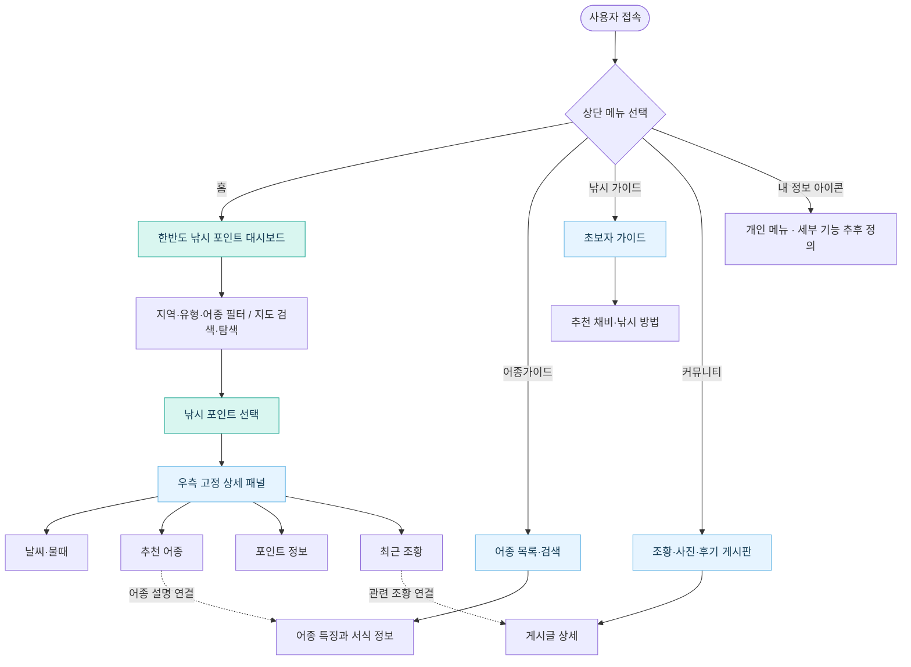
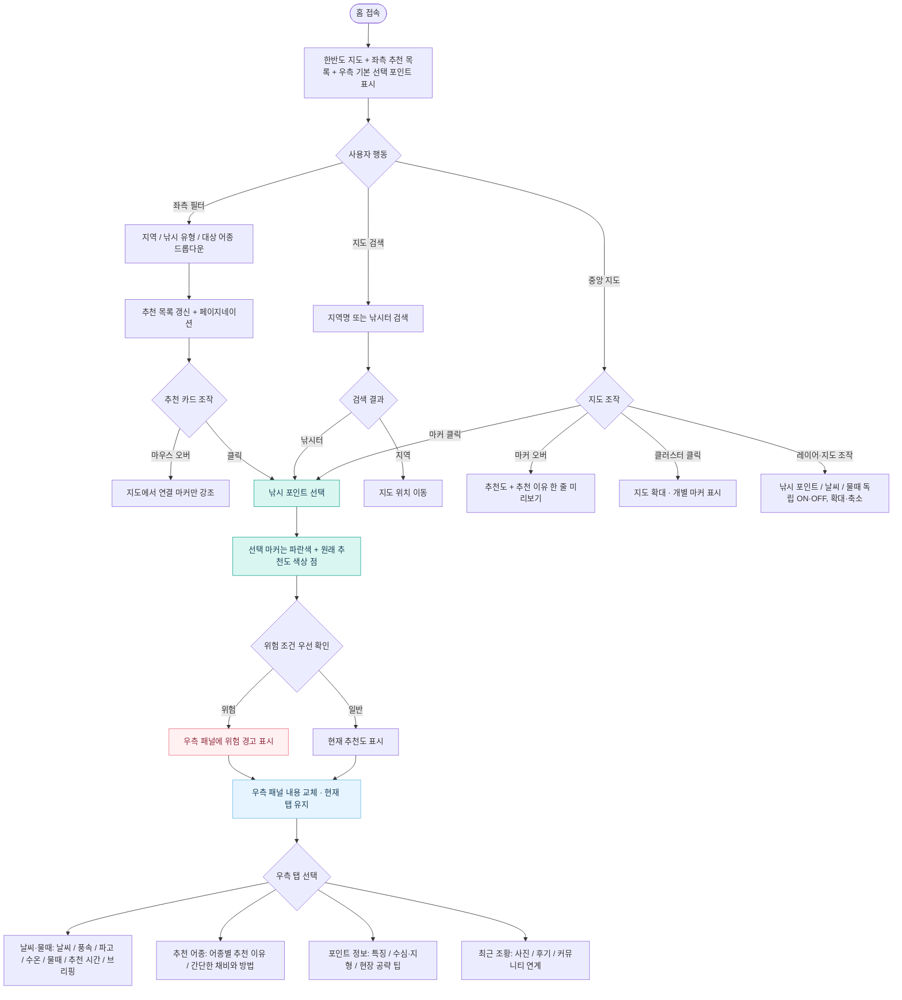

# 어딜 낚아 — 웹사이트 플로우차트

> 기준 시안: `메인페이지 시안.png` + `우측 패널 시안.png` (2026-10-26 확정)
>
> 본 문서는 **사용자 화면 이동 및 주요 상호작용**을 정리한 1차 플로우차트다. 화면에 표현되지 않은 세부 기능(내 정보 하위 메뉴, 개별 가이드 페이지 구조 등)은 추후 구현 단계에서 확정한다.

## 1. 전체 사이트 이동 흐름

## 2. 홈 화면 사용자 상호작용 상세 흐름

## 3. 주요 인터랙션 원칙

| 행동 | 화면 반응 |
|---|---|
| 추천 카드에 마우스 오버 | 해당 지도 마커만 강조, 우측 패널은 유지 |
| 추천 카드 또는 지도 마커 클릭 | 선택 마커 파란색 처리, 원래 추천도는 작은 색상 점으로 유지, 우측 패널 내용 교체 |
| 지도 마커 마우스 오버 | 짧은 정보 카드에 추천도 및 추천 이유 한 줄 표시 |
| 클러스터 클릭 | 해당 영역 확대, 우측 패널 선택은 변경하지 않음 |
| 지도 옵션 | 낚시 포인트 / 날씨 / 물때 세 레이어 독립 ON·OFF |
| 지역·포인트 변경 | 우측 패널의 현재 선택된 탭을 유지하고 콘텐츠만 전환 |
| 위험 조건 감지 | 일반 추천 점수보다 위험도를 우선, 위험 경고를 우측 패널에서 표시 |
| 홈 첫 접속 | 추천 또는 기본 포인트 하나를 선택해 우측 패널을 비우지 않음 |

## 4. 범위 및 확정 수준

- **화면에 보이는 구조 확정:** 상단 4개 메뉴, 좌측 드롭다운 3개와 추천 목록, 중앙 지도, 우측 4개 탭.
- **동작 설계:** 위 인터랙션 원칙은 기존 협의 사항을 반영한 구현 기준.
- **추후 상세 기획:** 어종가이드·낚시 가이드·커뮤니티의 세부 페이지, 계정/즐겨찾기 동작, 실제 API 연결, 데이터 결측 및 갱신 오류 처리.
